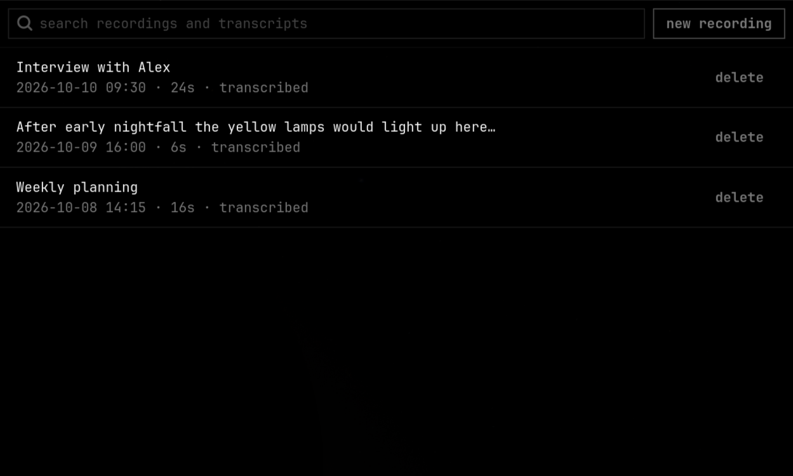
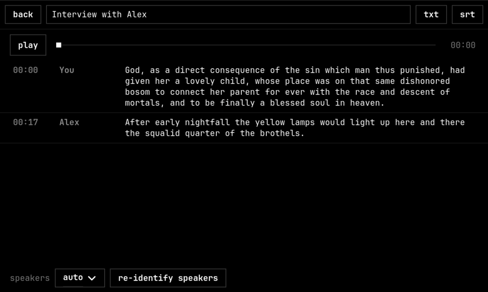
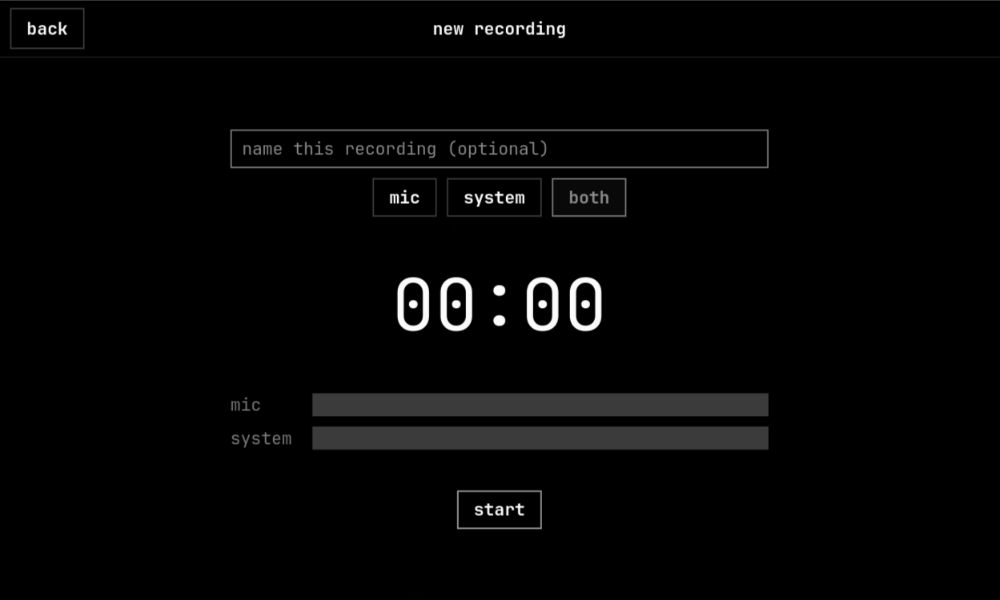

# scribe

Local, offline recorder + transcriber for Omarchy (GTK4 / libadwaita).

| Library | Transcript | Record |
|---|---|---|
|  |  |  |

_Screenshots show the Vantablack theme; the app follows whichever Omarchy theme is active. The demo audio is two short LibriSpeech clips._

- Records **mic**, **system audio** or **both** to one mixed **Opus** file.
- Transcribes with **Parakeet TDT v3** using the model voxtype already downloaded
  (`~/.local/share/voxtype/models/parakeet-tdt-0.6b-v3-int8`), with **word timestamps**.
- **Speaker diarization** (sherpa-onnx) on the mix. Speakers are anonymous ("Speaker 1", ...); the mic is
  never assumed to be one person. Rename or merge speakers, or force a speaker count.
- **Echo suppression** for "both" recordings: the mic is echo-cancelled against the system track
  before mixing, so the saved `.opus` has less speaker echo (the raw tracks are kept in `.tracks.opus`).
  Each track is then transcribed on its own, because Parakeet drops one voice when two overlap in one stream.
- Name a recording before, during or after; unnamed ones show the start of the transcript.
- Follows the active Omarchy theme (`~/.local/state/omarchy/current/theme/colors.toml`).

## Run

    python -m venv --system-site-packages .venv
    .venv/bin/pip install -e . pytest
    .venv/bin/python -m scribe        # or ./scribe.sh

Recordings live in `~/Recordings/Scribe/` (`<id>.opus`, `<id>.tracks.opus` for
both-source recordings, `<id>.json` with the transcript). Diarization models
(~45 MB) are downloaded once to `~/.local/share/scribe/models/` on first
transcription; this is the only network access.

## Known limitations

- Parakeet drops a voice when two people overlap in one stream (handled for mic+system by
  transcribing each track separately, but not for two people on the same track), and can return
  nothing for a chunk of clear speech (empty chunks are retried with different padding).
- Echo suppression reduces, not eliminates, speaker echo (about 5 dB less echo in a test recording).
- System capture records everything audible on the default sink.
- Diarization may over-split speakers; use rename-to-merge or the speaker count.

## Testing aids

- `SCRIBE_OPEN=record|<recording id>` opens that page at startup.
- `SCRIBE_RECORDINGS_DIR=<dir>` uses a different library; `SCRIBE_APP_ID=<id>` allows a second instance.
- Playback uses `mpv` (JSON IPC); recording needs `pw-record` (PipeWire) and `ffmpeg` with libopus.
