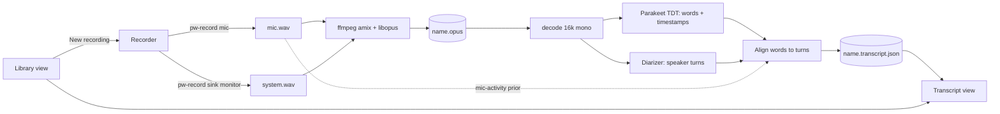

# Scribe — design

A local, offline GTK4/libadwaita app for Omarchy that records mic and/or system
audio to a single mixed Opus file, then transcribes it with Parakeet (reusing
voxtype's model) into a timestamped, speaker-labelled transcript.

## Goals

- Record **mic**, **system audio**, or **both**; output one mixed `.opus` file.
- On stop, auto-transcribe with `parakeet-tdt-0.6b-v3-int8` from
  `~/.local/share/voxtype/models/` (no second download).
- Transcript has **word-level timestamps** and **real speaker diarization**
  (clustered speakers, not just You/Them).
- Default view is a **browser of existing recordings**; "New recording" is the CTA.
- Minimal, flat, Omarchy-styled UI that follows the active Omarchy theme.
- Everything runs locally, CPU only (target machine: aarch64 M1, no GPU).

## Non-goals

- No cloud services, summaries, or LLM features.
- No editing of audio.
- No integration with voxtype's `meeting` mode or its `index.db`; Scribe owns its own library.
- No live (streaming) transcription in v1; transcription runs after stop.

## Stack

Python 3.14 + PyGObject (GTK4, libadwaita, GStreamer for playback), `pw-record`
for capture, `ffmpeg` (libopus) for mix/encode, `onnx-asr` + `onnxruntime` for
Parakeet, `sherpa-onnx` for diarization. Python deps live in a venv.
Fallback if aarch64 wheels fail: Rust for the affected component only.

## Architecture



### Units

| Unit | Purpose | Depends on |
|---|---|---|
| `recorder` | Start/stop `pw-record` per selected source; temp WAVs; crash recovery | PipeWire |
| `encoder` | Mix temp WAVs to one Opus file; also writes a 2-channel `name.tracks.opus` sidecar (mic, system) when both sources used | ffmpeg |
| `asr` | Chunked Parakeet inference, stitches words with absolute timestamps | onnx-asr, model dir |
| `diarize` | Speaker turns `[(start, end, speaker_id)]` | sherpa-onnx |
| `merge` | Assign each word a speaker by max overlap with turns; group into segments | pure Python |
| `library` | Scan `~/Recordings/Scribe/`, read sidecar metadata | filesystem |
| `theme` | Read active Omarchy theme colors, emit GTK CSS, reload on change | omarchy CLI |
| `ui` | Library, recording pane, transcript view | all of the above |

Each unit is importable and testable without GTK; `ui` is the only GTK consumer.

## Storage

`~/Recordings/Scribe/` (configurable later), per recording:

- `<YYYY-MM-DD_HHMM>.opus`: mixed audio (the deliverable).
- `<YYYY-MM-DD_HHMM>.tracks.opus`: only when both sources were recorded.
- `<YYYY-MM-DD_HHMM>.json`: metadata and transcript.

```json
{
  "title": "2026-10-10 14:30",
  "duration": 1834.2,
  "sources": ["mic", "system"],
  "model": "parakeet-tdt-0.6b-v3-int8",
  "status": "transcribed",
  "speakers": { "S0": "You", "S1": "Speaker 2" },
  "words": [{ "s": 0.48, "e": 0.72, "t": "Hello", "spk": "S0" }],
  "segments": [{ "s": 0.48, "e": 6.1, "spk": "S0", "text": "Hello everyone ..." }]
}
```

`status` is `recorded | transcribing | transcribed | failed`. Exports: `.txt` and
`.srt` generated from `segments` on demand.

## Transcription

1. Decode Opus to 16 kHz mono float.
2. Parakeet via onnx-asr from the voxtype model dir (path checked at startup;
   if missing, show "Run `voxtype setup model` to install", never download a copy).
   Chunk ~60 s with ~2 s overlap; drop duplicate words in the overlap; offset by
   chunk start. Report progress to the UI.
3. Run diarization on the full 16 kHz audio (pyannote segmentation +
   speaker-embedding model through sherpa-onnx, agglomerative clustering).
4. Merge: each word gets the speaker whose turn overlaps it most; consecutive
   same-speaker words form a segment.

### Diarization details

- Diarization models (~40 MB) are not shipped by voxtype. They are downloaded
  once to `~/.local/share/scribe/models/` on first use, with a visible prompt
  (the only network access the app ever makes).
- **No automatic "You":** several people can share the mic, so speakers are fully anonymous and come
  only from diarization on the mix. (Superseded the original mic-prior idea.)
- **Both-source recordings:** the mic is echo-cancelled against the system track (offline partitioned-block
  NLMS), the cleaned mic is mixed with the system track for the saved file, and each track is transcribed
  separately (words merged by time, mic words duplicating system words dropped).
- Speaker count is auto-estimated; the transcript view lets the user rename any
  speaker (persisted in `speakers`) and re-run with a forced speaker count.
- Mic-only or system-only recordings use diarization alone, without the prior.

## UI

Single `Adw.Application`, one window, `Adw.NavigationView` with three pages.
Minimal and flat: monospace-leaning type (system monospace, currently
JetBrainsMono Nerd Font), no gradients or shadows, 1px borders in the theme
border color, no decorative icons, small caps-free lowercase labels.

1. **Library (default).** Header: app name left, `New recording` button right
   (accent color, the only filled control). Body: a plain list, one row per
   recording: title, date, duration, status text (`transcribed`, `transcribing 42%`,
   `failed`). Search entry filters by title and transcript text. Empty state:
   one line of text and the CTA.
2. **Recording.** Pushed on "New recording". Source selector (`mic`, `system`,
   `both`), large elapsed timer, thin level meter per active source, a single
   `Stop` button. On stop: encode, push the transcript page, begin transcribing.
3. **Transcript.** Header: back, title (editable), `export`. Body: playback bar
   (play/pause, seek) and the segment list: `[mm:ss]  Speaker  text`, speaker
   names clickable to rename, timestamps clickable to seek. The active segment
   highlights during playback. Shows a progress line while transcribing and
   Retry on failure.

### Theming

Omarchy themes provide `colors.toml` (`omarchy theme dir <current>`). The `theme`
unit maps those colors to libadwaita named colors (`window_bg_color`,
`accent_bg_color`, `window_fg_color`, ...) via a generated CSS provider, and
reloads when the theme changes (a `theme-set` hook touches a state file Scribe
watches). Whether libadwaita already follows the theme without this is checked in
the first spike; the CSS provider is the guaranteed fallback.

## Error handling

- No sink monitor / no mic: the recording pane disables that source with a reason.
- Model dir missing: library banner with the fix command; recording still works.
- Transcription or diarization failure: audio is kept, status `failed`, Retry.
  Diarization failure alone degrades to a transcript with a single speaker and a notice.
- App killed mid-recording: on next launch, leftover temp WAVs are encoded into a
  recording marked `recorded` and offered for transcription.
- Disk full or ffmpeg error: surfaced in-pane, temp WAVs retained.

## Testing

- **Spikes first (gate before building UI):**
  1. `onnx-asr` + voxtype model transcribes a sample on aarch64/Python 3.14 and
     yields word timestamps.
  2. `sherpa-onnx` diarization installs and runs on aarch64 and separates a
     two-voice sample. If it fails, decide between a Rust implementation, another
     Python 3.x via mise, or reducing scope to the mic/system two-track split.
  3. libadwaita picks up (or can be driven by) the Omarchy theme colors.
- **Unit tests (pytest):** mix/encode of synthetic tones through ffmpeg;
  chunk stitching and overlap dedup; word-to-speaker merge and segment grouping;
  mic-prior speaker labelling; metadata read/write and crash recovery.
- **Manual:** record each source mode, transcribe, rename a speaker, seek from a
  timestamp, switch Omarchy theme while running.

## Risks

- aarch64 wheels for `onnxruntime` / `sherpa-onnx` on Python 3.14 (mitigation: mise Python 3.12/3.13, or Rust).
- Diarization accuracy with overlapping speech; mitigated by the mic prior and manual rename.
- CPU time on M1: transcription is roughly real-time or faster, diarization adds to it. Progress is always visible and the UI never blocks.
- Capturing the default sink monitor records everything audible, including the user's own speaker output of music.
